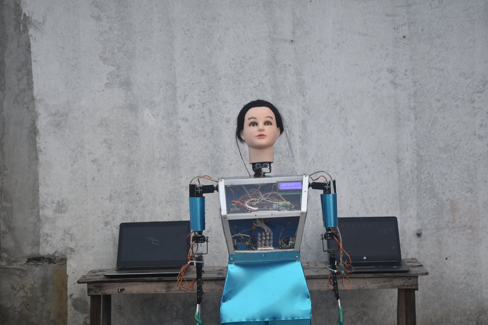
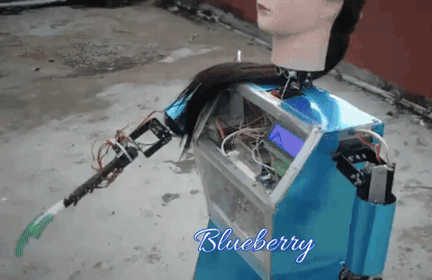
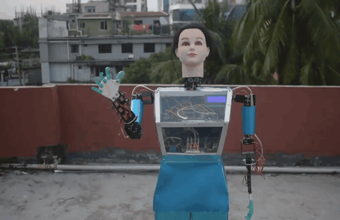
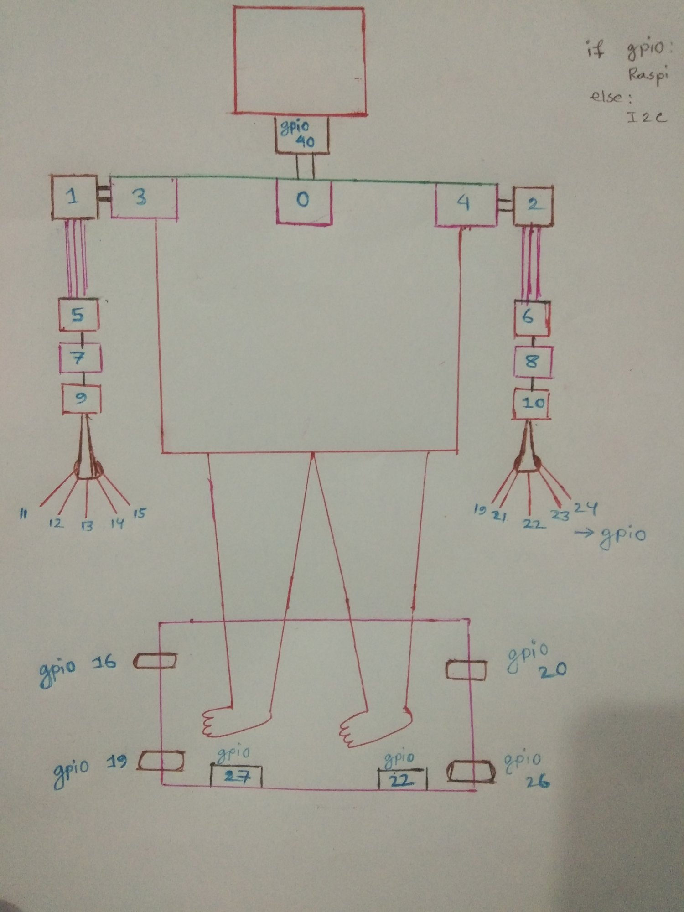
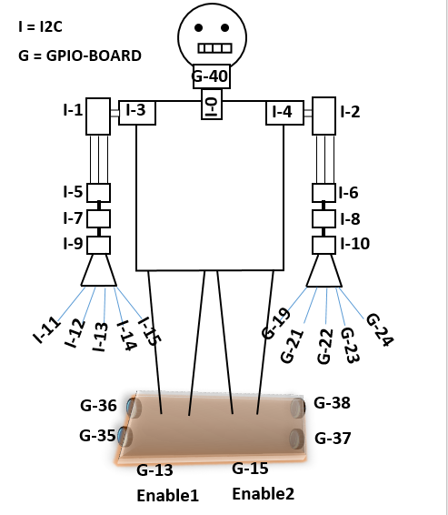
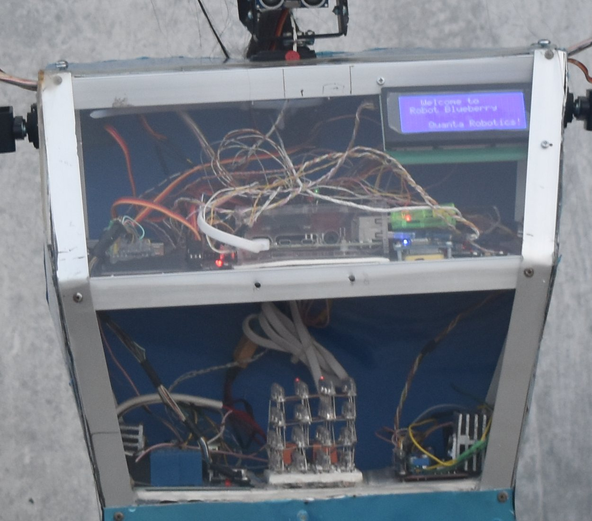
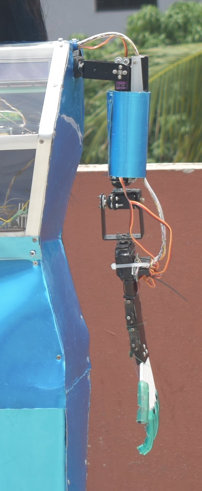
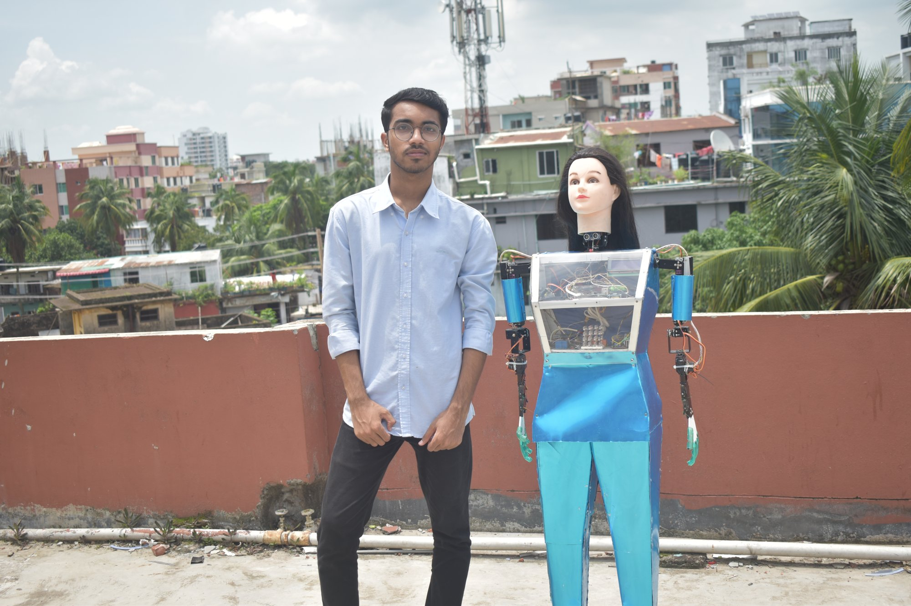
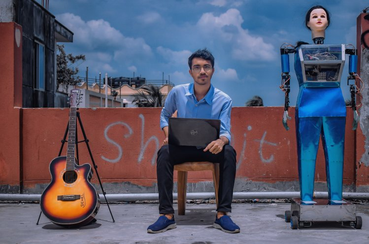

# Robot Blueberry

A talking humanoid robot, built in 2021 by Quanta Robotics, the robotics
team I co-founded at Comilla University. It answers questions, follows voice
commands with its arms and hands, and drives on a wheeled base. It runs
Python on a Raspberry Pi, with an Arduino Mega for its chest display.



| | | |
|---|---|---|
| <br>Moving both arms | <br>A salute | <br>Waving goodbye |

**Videos:**

- [Blueberry moving its arms](https://www.youtube.com/watch?v=-AMyVkIAMAI)
  (30 s, July 2021)
- [Its hand movements](https://www.youtube.com/watch?v=t3SgklDZivI)
  (26 s, July 2021)

Both are on Quanta Robotics' YouTube channel.

## What it does

- **Talks.** It wakes to its own wake word (Porcupine) and listens through
  an online assistant. It knows 99 questions from
  [`config/conversation.yaml`](config/conversation.yaml) and speaks their
  answers itself, moving its head and arms as it talks; the assistant
  answers the rest.
- **Moves on voice commands.** Spoken commands start 20 of its moves
  ([`src/movement/`](src/movement)): hands up, a handshake, a hug, a
  salute, a namaskar, a nod or a head shake, touching its eye, moving each
  arm, a goodbye wave, an introduction of the team, the national anthem
  (played from a recording while it holds a pose), and a tribute to
  Bangabandhu. A command is the first phrase of its entry in
  `config/conversation.yaml`, heard anywhere in a sentence; 9 of the 51
  entries name scripts that were never written.
- **Drives** on two DC motors: forward, back and turns.
- **Watches its sensors** when told "active sensor": every two seconds it
  warns out loud of gas, smoke, darkness, or a tilt read by an MPU-6050.
  Its fire sensor only prints a line.
- **Shows** a welcome on a 20 × 4 LCD in its chest, and runs a
  4 × 4 × 4 LED cube, from an Arduino Mega
  ([`firmware/led-cube-lcd/`](firmware/led-cube-lcd)).
- **Starts by itself** at boot, as a systemd service.

**Written but not started by voice:** [`src/movement/automatic.py`](src/movement/automatic.py)
drives on its own and backs away from obstacles with an ultrasonic sensor;
it is run by hand, as are 15 other scripts there, such as `circle.py`,
`dance.py` and `swim.py`. [`src/gps/gps-map.html`](src/gps/gps-map.html)
shows a location from a ThingSpeak channel on a map; nothing in the repo
reads a GPS module.

## The design

| | |
|---|---|
| <br>**2021-05-16:** the first servo plan, drawn by hand: each servo numbered on a body outline, the GPIO ones marked | <br>**2021-05-23:** the same plan redrawn: each servo's channel on the I2C driver (I-) or pin on the Raspberry Pi (G-), and the base's motor pins |

## The build

| | | |
|---|---|---|
| <br>**2021-06-21:** inside the clear chest: the Raspberry Pi, the welcome on the LCD, and the LED cube | <br>**2021-06-23:** one arm: servos in metal brackets from the shoulder down, and a servo for each finger | <br>**2021-06-23:** me with the finished Blueberry on the rooftop |
| <br>Me at a laptop beside Blueberry, on its wheeled base | | |

## How it works

| | |
|---|---|
| Body | A metal torso with clear panels, a mannequin head and servo arms, on a wheeled base |
| Servos | 22: 16 on a PCA9685 board through Adafruit ServoKit (I2C), and 6 on the Raspberry Pi's GPIO (BCM 12, 11, 8, 10, 9 and 25), driven by [`src/move.py`](src/move.py). Their pins and positions are in [`config/configuration.yaml`](config/configuration.yaml) |
| Voice | A Porcupine wake word, an online assistant for listening and open questions, and gTTS for its own answers ([`src/talk.py`](src/talk.py)); [`src/move_while_speaking.py`](src/move_while_speaking.py) moves the head and arms while it talks |
| Motors | Two DC motors on an H-bridge: right on enable 27 and inputs 19 and 16, left on enable 22 and inputs 26 and 20 |
| Sensors | Gas, smoke, fire and light on GPIO 4, 7, 13 and 21, and an MPU-6050 on I2C (0x68) for tilt ([`src/sensor.py`](src/sensor.py)); an ultrasonic sensor (trigger 24, echo 23) for the self-driving script ([`src/movement/automatic.py`](src/movement/automatic.py)) |
| Lights | A listening light on GPIO 5 and a speaking light on GPIO 6 ([`src/indicator.py`](src/indicator.py)) |
| Arduino | An Arduino Mega runs the 20 × 4 I2C LCD (0x27) and the LED cube |
| System | Python 3 on a Raspberry Pi, started at boot by a systemd service ([`systemd/robot.service`](systemd/robot.service)) |

## Repository layout

| Folder | Holds |
|---|---|
| [`src/`](src) | The program: [`main.py`](src/main.py), the voice that runs at boot, and the modules it uses for talking, moving, sensors and lights |
| [`src/movement/`](src/movement) | One script per move: 20 are started by voice commands, the rest by hand; `expression.py` loads what they share |
| [`src/gps/`](src/gps) | The GPS map page |
| [`config/`](config) | What Blueberry answers and does for each phrase, and its servos' pins and positions |
| [`assets/`](assets) | Its sounds; `assets/models/` is for your wake-word file |
| [`firmware/`](firmware) | The Arduino Mega sketch for the LCD and the LED cube |
| [`scripts/`](scripts) | The installers, the list of system packages and the USB sound card setup |
| [`systemd/`](systemd) | The service that starts Blueberry at boot |
| [`docs/`](docs) | The servo map, the commands for running the robot, the 2021 photos (`photos/`) and this page's images (`media/`) |
| [`experiments/`](experiments) | The first tests from 2021: servos, motors, speech, and textbook exercises |

## My part

Blueberry was built by Quanta Robotics, the robotics team I co-founded at
Comilla University: Shanjit Mondol ([@shanjit11](https://github.com/shanjit11))
led the team and designed the circuits and the mechanics, and Mestu Paul
([@Mestu-Paul](https://github.com/Mestu-Paul)) and I wrote the code. Most of
the commits here are mine. Mestu Paul wrote the first Arduino sketch, which I
reworked.

It stands on others' work:

- The voice program, the installers and the audio setup started from
  Shivasiddharth's
  [GassistPi](https://github.com/shivasiddharth/GassistPi), which carries
  Google's Assistant samples (Apache 2.0).
- The wake-word loop follows Picovoice's
  [Porcupine](https://github.com/Picovoice/porcupine) 1.9 Python demo
  (Apache 2.0).
- The MPU-6050 reader in [`src/sensor.py`](src/sensor.py) comes from
  [m-rtijn/mpu6050](https://github.com/m-rtijn/mpu6050) (MIT).
- The LED cube's patterns follow a widely shared 4 × 4 × 4 LED-cube sketch
  whose author I couldn't find.
- [`experiments/cookbook-exercises/`](experiments/cookbook-exercises) holds
  exercises from Simon Monk's Raspberry Pi Cookbook and Adafruit's
  CircuitPython Essentials (both MIT).

## Press

Blueberry was in the Bangladeshi news in June and July 2021. These reports
are still online:

- **23 June:** [Bangladesh Bulletin](https://bangladeshbulletin.com/?p=53978), [Banglar Jagoron](https://banglarjagoron.com/archives/17925), [BD Campus TV](https://web.archive.org/web/20211022122931/https://bdcampus-tv.com/%E0%A6%95%E0%A7%81%E0%A6%AC%E0%A6%BF-%E0%A6%B6%E0%A6%BF%E0%A6%95%E0%A7%8D%E0%A6%B7%E0%A6%BE%E0%A6%B0%E0%A7%8D%E0%A6%A5%E0%A7%80%E0%A6%A6%E0%A7%87%E0%A6%B0-%E0%A6%B0%E0%A7%8B%E0%A6%AC%E0%A6%9F/) (archived copy), [Bhorer Kagoj](https://www.bhorerkagoj.net/2021/06/23/%E0%A6%8F%E0%A6%AC%E0%A6%BE%E0%A6%B0-%E0%A6%A6%E0%A7%8D%E0%A6%AC%E0%A6%BF%E0%A6%A4%E0%A7%80%E0%A7%9F-%E0%A6%B0%E0%A7%8B%E0%A6%AC%E0%A6%9F-%E0%A6%AC%E0%A7%8D%E0%A6%B2%E0%A7%81%E0%A6%AC%E0%A7%87), [Cumillar Paper](https://cumillarpaper.com/%E0%A6%95%E0%A7%81%E0%A6%AC%E0%A6%BF-%E0%A6%B6%E0%A6%BF%E0%A6%95%E0%A7%8D%E0%A6%B7%E0%A6%BE%E0%A6%B0%E0%A7%8D%E0%A6%A5%E0%A7%80%E0%A6%A6%E0%A7%87%E0%A6%B0-%E0%A6%A8%E0%A6%A4%E0%A7%81%E0%A6%A8-2), [Daily Bangladesh](https://www.daily-bangladesh.com/education/255286), [Jugantor](https://www.jugantor.com/tech/434899/%E0%A6%95%E0%A6%B0%E0%A7%8B%E0%A6%A8%E0%A6%BE%E0%A6%B0-%E0%A6%A8%E0%A6%AE%E0%A7%81%E0%A6%A8%E0%A6%BE-%E0%A6%B8%E0%A6%82%E0%A6%97%E0%A7%8D%E0%A6%B0%E0%A6%B9-%E0%A6%95%E0%A6%B0%E0%A6%AC%E0%A7%87-%E0%A6%B0%E0%A7%8B%E0%A6%AC%E0%A6%9F-%E0%A6%AC%E0%A7%8D%E0%A6%B2%E0%A7%81%E0%A6%AC%E0%A7%87%E0%A6%B0%E0%A6%BF), [Observer BD](https://bn.observerbd.com/details.php?id=63913), [Samakal](https://samakal.com/whole-country/article/210666558/%E0%A6%95%E0%A6%A5%E0%A6%BE-%E0%A6%AC%E0%A6%B2%E0%A6%9B%E0%A7%87-%E0%A6%AC%E0%A7%8D%E0%A6%B2%E0%A7%81%E0%A6%AC%E0%A7%87%E0%A6%B0%E0%A6%BF), [Somoy Journal](https://somoyjournal.com/news-post/4072/%E0%A6%B0%E0%A7%8B%E0%A6%AC%E0%A6%9F-'%E0%A6%AC%E0%A7%8D%E0%A6%B2%E0%A7%81%E0%A6%AC%E0%A7%87%E0%A6%B0%E0%A6%BF'-%E0%A6%AC%E0%A6%BE%E0%A6%A8%E0%A6%BE%E0%A6%B2%E0%A7%87%E0%A6%A8-%E0%A6%95%E0%A7%81%E0%A6%AE%E0%A6%BF%E0%A6%B2%E0%A7%8D%E0%A6%B2%E0%A6%BE-%E0%A6%AC%E0%A6%BF%E0%A6%B6%E0%A7%8D%E0%A6%AC%E0%A6%AC%E0%A6%BF%E0%A6%A6%E0%A7%8D%E0%A6%AF%E0%A6%BE%E0%A6%B2%E0%A7%9F%E0%A7%87%E0%A6%B0-%E0%A6%B6%E0%A6%BF%E0%A6%95%E0%A7%8D%E0%A6%B7%E0%A6%BE%E0%A6%B0%E0%A7%8D%E0%A6%A5%E0%A7%80%E0%A6%B0%E0%A6%BE), [Somoy News](https://web.archive.org/web/20210623065035/https://somoynews.tv/news/2021-06-23/%E0%A6%B0%E0%A7%8B%E0%A6%AC%E0%A6%9F-%E0%A6%AC%E0%A7%8D%E0%A6%B2%E0%A7%81%E0%A6%AC%E0%A7%87%E0%A6%B0%E0%A6%BF-%E0%A6%A4%E0%A7%88%E0%A6%B0%E0%A6%BF-%E0%A6%95%E0%A6%B0%E0%A6%B2-%E0%A6%95%E0%A7%81%E0%A6%AC%E0%A6%BF-%E0%A6%B6%E0%A6%BF%E0%A6%95%E0%A7%8D%E0%A6%B7%E0%A6%BE%E0%A6%B0%E0%A7%8D%E0%A6%A5%E0%A7%80) (archived copy), [The Daily Campus](https://thedailycampus.com/innovation-research/70807/%E0%A6%95%E0%A6%B0%E0%A7%8B%E0%A6%A8%E0%A6%BE%E0%A6%B0-%E0%A6%A8%E0%A6%AE%E0%A7%81%E0%A6%A8%E0%A6%BE-%E0%A6%B8%E0%A6%82%E0%A6%97%E0%A7%8D%E0%A6%B0%E0%A6%B9-%E0%A6%95%E0%A6%B0%E0%A6%AC%E0%A7%87-%E0%A6%95%E0%A7%81%E0%A6%AC%E0%A6%BF-%E0%A6%B6%E0%A6%BF%E0%A6%95%E0%A7%8D%E0%A6%B7%E0%A6%BE%E0%A6%B0%E0%A7%8D%E0%A6%A5%E0%A7%80%E0%A6%A6%E0%A7%87%E0%A6%B0-%E0%A6%B0%E0%A7%8B%E0%A6%AC%E0%A6%9F-%E0%A6%AC%E0%A7%8D%E0%A6%B2%E0%A7%81%E0%A6%AC%E0%A7%87%E0%A6%B0%E0%A6%BF)
- **24 June:** [Amader Shomoy](https://www.amadershomoy.com/bn/2021/06/24/1395734.asp), [Shomoyer Alo](https://www.shomoyeralo.com/news/148649)
- **25 June:** [MCJ News](https://www.facebook.com/mcjnews/posts/1613278385545042) on Facebook
- **On TV, on YouTube:** [Channel Bangladesh](https://www.youtube.com/watch?v=PQB5FxanlwU) (23 June), [News Plus](https://www.youtube.com/watch?v=7mf9sh0X7QE) (25 June), [mohanagarnews24](https://www.youtube.com/watch?v=GOQwzYt7nyU) (29 June), [Jamuna TV](https://www.youtube.com/watch?v=Ku7SMQkh_QA) (7 July), [Natuncumilla](https://www.youtube.com/watch?v=tX2ss9PVKOo) (22 July)

Some headlines said Blueberry would collect corona samples or warn of fire.
It does neither: no code here collects samples, and its fire sensor only
prints a line.

## Run it

Blueberry ran on Raspberry Pi OS in 2021, with the assistant library 1.1.0
and Porcupine 1.9. Both are now out of date, and
[`requirements.txt`](requirements.txt) lists 2021's packages but pins only
some of their versions, so these steps record how it was set up; they are
not tested on today's Raspberry Pi OS.

You need a Raspberry Pi with I2C switched on (`sudo raspi-config`), wired to
Blueberry's servo board, motors, sensors, microphone and speaker, and the
Arduino Mega plugged in over USB: the program opens `/dev/ttyACM0` as it
starts.

1. Put an OAuth client file for the online assistant at `~/robot.json`. The
   installer signs in with it as its last step.
2. Clone the repository and run the installer:

   ```bash
   git clone https://github.com/jewel-nath/robot-blueberry ~/robot-blueberry
   cd ~/robot-blueberry
   ./scripts/install.sh
   ```

   It adds the system packages in
   [`scripts/apt-packages.txt`](scripts/apt-packages.txt) and makes a Python
   environment in `~/env` from [`requirements.txt`](requirements.txt).
3. Make the folder `assets/models/` and put a Porcupine wake-word file in it
   as `blueberry.ppn`. The 2021 file, made for Porcupine 1.9 in the
   Picovoice Console, isn't in the repository.
4. In [`systemd/robot.service`](systemd/robot.service), change the project
   and device model IDs to yours.
5. Install the service and start it:

   ```bash
   sudo ./scripts/install-service.sh
   sudo systemctl enable --now robot.service
   ```

For a USB sound card, run `sudo ./scripts/audio/install-usb-sound-card.sh`
first. [`docs/commands.md`](docs/commands.md) has the commands for
connecting to the robot and restarting it. To use the GPS map page, put your
Google Maps key, ThingSpeak channel and read key in place of the
placeholders in [`src/gps/gps-map.html`](src/gps/gps-map.html).

**Known gaps in the 2021 setup:**

- [`src/sensor.py`](src/sensor.py) imports `smbus`, which neither package
  list installs.
- The moves run with the system's `python3`, outside `~/env`, because the
  service's `PATH` doesn't include `~/env/bin`.
- The sensor check calls itself every two seconds, so it stops after about
  1,000 checks, a little over half an hour.

## Licence

The code is under the MIT licence: see [LICENSE](LICENSE). Code that came
from another project carries a comment naming that project and its licence,
at the top of the file or above the borrowed part; the textbook exercises
are credited in [`experiments/README.md`](experiments/README.md).
GassistPi's licence is MIT with two conditions: its code may not be used
for competitions or submitted for assessments without its owner's
permission.
